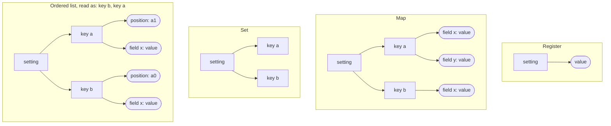
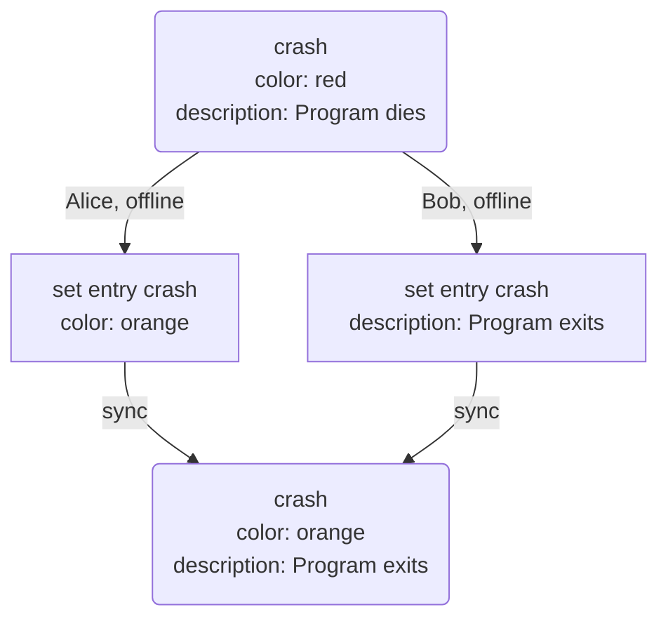

# Specification: config entity

This document specifies the `config` entity in git-bug: the settings shared by every clone
of a repository. It assumes familiarity with the generic DAG entity format described in
[dag-entity.md](dag-entity.md).


## 1. Overview

The config holds what every clone of a repository must agree on for the data to mean, or
validate, the same everywhere. What concerns one machine or one deployment (credentials,
bridges, web UI settings) stays in the local git configuration and is not part of this format.

A repository holds at most one config. A repository without a config behaves as if every
setting had its default.


## 2. Storage

| Property       | Value                          |
|----------------|--------------------------------|
| Namespace      | `config`                       |
| Git reference  | `refs/config/config`           |
| Format version | 1                              |
| Clocks         | `config-create`, `config-edit` |

The config is a singleton (see [dag-entity.md §2.1](dag-entity.md#21-singleton-entities)):
its reference is named `config`, not after its ID. Other references in the `config`
namespace are not entities and are ignored.

The config's ID equals the ID of its `CreateOperation`, like any entity (see
[ids.md](ids.md#2-derivation)). Each repository's config therefore has a random ID, and two
configs created independently are never merged together (see [§10](#10-merge)).


## 3. Sections

Settings are grouped in **sections**, one per feature area. A section owns its operation
types and its part of the snapshot.

| Section   | Number | Covers                                       |
|-----------|--------|----------------------------------------------|
| (config)  | 0      | The config itself, such as its creation      |
| `repo`    | 1      | The repository description                   |
| `labels`  | 2      | Label definitions, allowed labels            |

The operation types are numbered by section: section `N` uses the types `N × 10000 + 1` to
`N × 10000 + 9999`. The section of an operation is therefore `type / 10000` (integer
division), even for a type the reader does not know. Section numbers and operation types
never change once released.


## 4. Operation type constants

| Constant                  | Integer | Section   | Description                                                                |
|---------------------------|---------|-----------|----------------------------------------------------------------------------|
| `CreateOp`                | 1       | (config)  | Create the config (must be the first operation, and appear only once)      |
| `RepoSetDescriptionOp`    | 10001   | `repo`    | Set the repository description                                             |
| `LabelsSetOp`             | 20001   | `labels`  | Define a label, or change its definition                                   |
| `LabelsRemoveOp`          | 20002   | `labels`  | Remove the definition of a label                                           |
| `LabelsAllowOp`           | 20003   | `labels`  | Allow a label                                                              |
| `LabelsDisallowOp`        | 20004   | `labels`  | Disallow a label                                                           |

A reader **must** accept packs containing type values not listed above (see
[dag-entity.md §6.4](dag-entity.md#64-unknown-operation-types)).


## 5. Creation

A valid config's first operation **must** be a `CreateOperation` (type 1). No other
`CreateOperation` may appear in subsequent operations.

The ID of this operation becomes the config's ID. It has only the common fields
([§6](#6-common-fields)), `times` among them, and changes no setting.

```json
{
  "type": 1,
  "timestamp": 1609459200,
  "nonce": "rv5N8TwqB3sGKhBxVoNFPwAAAAA=",
  "times": {"bugs-create": 14, "bugs-edit": 137}
}
```


## 6. Common fields

All operations include the common fields defined in
[dag-entity.md §6.1](dag-entity.md#61-common-fields-present-in-every-operation). Every
operation of this entity also carries:

| Field         | JSON key | Type                    | Required | Description                                                        |
|---------------|----------|-------------------------|----------|--------------------------------------------------------------------|
| Lamport times | `times`  | object (string→integer) | yes      | Value of every clock of the repository when the operation was made |

The `times` map has the same form as the one of identity versions (see
[identity.md §4.1](identity.md#41-lamport-times-map)). It places the operation relative to
the operations of every other entity: the operation applies to those made after it
([§8.1](#81-eras)). A reader **must** tolerate unknown keys in `times`. A clock missing
from the map counts as 0.

An operation of a known type that doesn't follow this specification is invalid: for example
one without `times`, without a `key` its kind requires ([§7.2](#72-operations)), with `null`
other than to clear a field ([§7.1](#71-keys-and-values)), or with a value of the wrong type
or outside what its setting allows ([§9](#9-settings)). A reader **must** reject a config
holding an invalid operation, as a whole: when merging, it keeps its own config and reports
the remote one as invalid. An operation of an unknown type ([§4](#4-operation-type-constants))
is not invalid, nor is a valid operation carrying an unknown field ([§7.2](#72-operations)).


## 7. Setting shapes

A *setting* is one part of the config that people change, such as the repository
description or the allowed labels. Every setting has one of four *shapes*. The shape fixes
how the setting is structured, which operations change it, and which concurrent changes all
survive ([§7.3](#73-concurrent-changes)).

| Shape        | Structure                                  | Operations                  | Example                |
|--------------|--------------------------------------------|-----------------------------|------------------------|
| Register     | One value                                  | *set value*                 | Repository description |
| Map          | Entries by key, each holding named fields  | *set entry*, *remove entry* | Label definitions      |
| Set          | A map whose entries have no field          | *set entry*, *remove entry* | Allowed labels         |
| Ordered list | A map whose entries are sorted by position | *set entry*, *remove entry* | —                      |

A set and an ordered list are maps, with the same operations and the same JSON; they are
named apart because they are read differently.

A setting is therefore at most three levels deep: the setting, a key, a field. Each rounded
node below is a *register*: one value ([§7.1](#71-keys-and-values)), replaced as a whole.



### 7.1 Keys and values

A key identifies an entry of a map, a set or an ordered list. It is a non-empty string, and
keys are compared byte by byte.

A value is a string, an integer or a boolean:

| Type    | JSON                                 | Zero value |
|---------|--------------------------------------|------------|
| String  | A string                             | `""`       |
| Integer | Digits, with an optional leading `-` | `0`        |
| Boolean | `true` or `false`                    | `false`    |

An integer lies between −(2⁵³ − 1) and 2⁵³ − 1, so that every JSON implementation reads it
exactly. Each setting narrows its keys and the type of its values further, for example to a
single line, a maximum length, a fixed set of strings or a range of integers. A length is a
number of characters, counted as Unicode code points, not as bytes.

There are no other values: no `null`, which clears a field ([§7.2](#72-operations)), no
objects or arrays, and no fractional numbers. Anything structured is a map, a set or an
ordered list.

### 7.2 Operations

An operation that changes a setting is of one of three *kinds*. On top of the common fields
([§6](#6-common-fields)), it has the JSON keys of its kind:

| Kind           | JSON keys       | Effect                                                                     |
|----------------|-----------------|----------------------------------------------------------------------------|
| *set value*    | `value`         | Replaces the value of the register                                         |
| *set entry*    | `key`, `fields` | Adds the entry if it is absent, then changes the fields listed in `fields` |
| *remove entry* | `key`           | Removes the entry and clears all its fields                                |

For *set value*, `value` is omitted when it is the zero value, and is never `null`. A reader
**must** read a missing `value` as the zero value.

For *set entry*, `fields` is an object whose members are the fields to change. Each field
is:

- absent: it keeps its value;
- `null`: it is cleared, and reads as its default;
- a value: it takes that value.

`fields` is omitted when it would be empty, and is never `null`: the operation then only
adds the entry, if absent. A reader **must** read an empty `fields` object the same way. A reader **must**
ignore the fields it does not know and apply the others, so that a field can be added to a
map later without a new operation type ([§7.5](#75-adding-a-setting)).

On a set, a *set entry* lists no field: it adds the key. A *remove entry* removes it.

For example, with the common fields left out:

```json lines
{"type": 10001, "value": "A distributed bug tracker"}
{"type": 20001, "key": "crash", "fields": {"color": "#f44336", "description": null}}
{"type": 20003, "key": "crash"}
{"type": 20002, "key": "crash"}
```

1. Type 10001, a *set value* on the repository description: the description becomes
   "A distributed bug tracker".
2. Type 20001, a *set entry* on the label definitions: the entry `crash` is added if
   absent. Its `color` becomes `#f44336`, its `description` is cleared, and its other fields
   keep their value.
3. Type 20003, a *set entry* on the allowed labels, a set: the key `crash` is added, which
   allows the label `crash`.
4. Type 20002, a *remove entry* on the label definitions: the entry `crash` is removed
   with all its fields, so the label `crash` has no definition any more.

Complete operations, with their common fields, are in the test vectors
([§11](#11-test-vectors)).

### 7.3 Concurrent changes

Operations are applied in the total operation order
([dag-entity.md §9](dag-entity.md#9-operation-ordering)), and the last change wins,
separately for:

- the value of a register;
- whether each entry of a map is present, which for a set is whether each key is present;
- each field of each entry of a map.

An operation affects nothing beyond what it changes. So if, while offline, one maintainer
changes the color of a label and another its description, both changes stay once they sync.
If both change its color, the operation that sorts last wins. If one changes the label while
the other removes it, the operation that sorts last decides: a removal sorting last removes
the label with all its fields, and a change sorting last adds it back with only the fields
that change sets.

The first case, for the label `crash`:



The label definitions after each of these operations, applied in this order:

| # | Operation                                       | Label definitions after it                  |
|---|-------------------------------------------------|---------------------------------------------|
| 1 | *set entry* `crash`: color red                  | `crash` (red)                               |
| 2 | *set entry* `crash`: description "Program dies" | `crash` (red, "Program dies")               |
| 3 | *set entry* `regression`                        | `crash` (red, "Program dies"), `regression` |
| 4 | *remove entry* `crash`                          | `regression`                                |
| 5 | *set entry* `crash`: color blue                 | `crash` (blue), `regression`                |

At step 5, `crash` gets no description back: the removal at step 4 cleared it.

The operations of one pack sort together in the total operation order: operations from
other packs cannot appear between them. For example, restricting the labels to the defined
ones, with a `LabelsAllowOperation` for each defined label, is best written as one pack.
Concurrent changes still resolve separately for each entry and field.

### 7.4 Ordered lists

An ordered list is a map whose entries have a `position` field. The entries are listed by
position, compared byte by byte. Entries with the same position are listed by key, and
entries without a position come last, by key.

A position is a fractional index, in the format described by David Greenspan in
[Implementing Fractional Indexing](https://observablehq.com/@dgreensp/implementing-fractional-indexing).
It is a string of the digits `0`–`9`, `A`–`Z` and `a`–`z`, whose order is also the order of
their bytes, made of two parts:

1. An integer part, whose first character, a letter, gives its length, that character
   included: 2 for `a`, 3 for `b`, up to 27 for `z`, and 2 for `Z`, 3 for `Y`, up to 27 for
   `A`. The lowercase letters start the integers from `a0` upward, the uppercase ones those
   below it: `Zy`, `Zz`, `a0`, `a1`, …, `az`, `b00`, `b01`.
2. A fractional part: the rest of the string, possibly empty, not ending with `0`.

`A` followed by 26 `0`, with nothing after it, is not a position. A *set entry* that sets an
invalid position is invalid ([§6](#6-common-fields)).

There is always a position before another, after another, and between two different ones:
`Zz` lies before `a0`, `a1` after `a0`, `a0V` between `a0` and `a1`, and `a0G` between `a0`
and `a0V`. A client adding at either end can step the integer part (`a1`, `a2`, …), so that
the positions stay short when entries are added one after another.

A client that adds an entry **must** give it a position. A client inserts or moves an entry
by setting its `position`, and **must** set it between the positions of its new neighbours,
or before the first or after the last entry, without changing any other entry. When no
position lies between the new neighbours, because they have the same position or have none,
the client **must** first move enough of the entries involved to new positions, in the same
pack and keeping their order, so that one does.

For example, `x` is at `a0` and `y` at `a1`. Alice inserts `p` between them at `a0V`. Bob,
offline, inserts `q` there as well, and also picks `a0V`. Once they sync, both have the same
position and are listed by key: `x`, `p`, `q`, `y`. To insert `r` between `p` and `q`, Carol
writes one pack that first moves `q` to `a0l`, between `a0V` and `a1`, then sets `r` at
`a0d`, between `a0V` and `a0l`. The list becomes `x`, `p`, `r`, `q`, `y`.

So two concurrent inserts both take effect, and two concurrent moves of the same entry are
two changes of its `position`, of which the last wins. As `position` is a field like any
other, moving an entry and changing another of its fields concurrently both take effect.

### 7.5 Adding a setting

This section is for whoever adds a setting to this specification. It puts no requirement on
readers or writers of the format.

Of two concurrent changes, both survive only if they touch different entries, or different
fields of the same entry ([§7.3](#73-concurrent-changes)). A new setting is therefore laid
out to match how people change it:

- a value changed as a whole is a register, like the repository description;
- items added and removed one at a time, with nothing more to them, are a set, like the
  allowed labels;
- items with properties changed one at a time are a map, with a field per property, like the
  color and the description of a label;
- items whose order matters are an ordered list.

Fields that must agree with each other, such as the two bounds of a range, are written
together: the setting requires every *set entry* to list all of them, with `null` for those
it clears, so that the last one sets them all at once: `"fields": {"min": 1, "max": 5}`,
never `"fields": {"min": 1}` alone.

A field holds a single value, so a list that belongs to an item, such as the permissions of
a role, is another setting: a set of pairs of role and permission. Removing a role then also
removes its permissions, in the same operation.

A field added to an existing map, or to the entries of a set, **must not** change what is
valid: a reader that doesn't know it ignores it, and judges as if it were absent. A change
of what is valid is a new setting, with operation types of its own, which such a reader
doesn't know ([§4](#4-operation-type-constants)).

Unrelated facts about the same items are separate settings with the same keys: the label
definitions and the allowed labels are both keyed by label name, and removing a definition
doesn't disallow the label.


## 8. Snapshot semantics

The snapshot is built by applying operations in the order defined in
[dag-entity.md §9](dag-entity.md#9-operation-ordering). A setting that was never set reads
as its default.

| Section   | Setting                | Shape    | Default                  |
|-----------|------------------------|----------|--------------------------|
| `repo`    | Repository description | register | empty                    |
| `labels`  | Label definitions      | map      | none                     |
| `labels`  | Allowed labels         | set      | empty: any label allowed |

The color of a label is the one its definition sets, otherwise the color derived from its
name ([§9.2](#92-label-definitions)).

This snapshot, built from every operation, is the config as it is now. The operations of
other entities are judged by the config of their era instead ([§8.1](#81-eras)).

### 8.1 Eras

An operation of another entity is judged by the config as it was when that operation was
made, not by the latest config.

Each config operation records in `times` the value of every clock of the repository when it
was made ([§6](#6-common-fields)), and applies to the operations made after it: on a clock
`c`, to the times above `times[c]`. An operation of another entity at time `t` on `c` is
therefore judged by the config operations whose `times[c]` is lower than `t`, applied in the
total operation order. An operation at time `times[c]` or earlier was made before the config
operation, and is judged without it.

The time of an operation of a DAG entity is the `edit-clock` of its pack, on the edit clock
of its namespace, `<namespace>-edit` (see [dag-entity.md §8](dag-entity.md#8-lamport-clocks)).
For a bug, that is `bugs-edit`.

Along a clock, the distinct values recorded by the config operations cut the times into
**eras**: the config is the same for every time of an era. The first era, up to the lowest
recorded value, has no config operation: every setting reads as its default.

For example, with these config operations in the total operation order, after the
`CreateOperation`, which changes nothing:

| # | Operation                                                  | `times["bugs-edit"]` |
|---|------------------------------------------------------------|----------------------|
| 1 | *set entry* `crash` on the label definitions: color red    | 42                   |
| 2 | *set entry* `crash` on the allowed labels                  | 50                   |
| 3 | *set value* on the repository description: "A bug tracker" | 30                   |

Operation 3 sorts last but records an earlier time: it was made in a clone whose bugs were
behind, then merged. The eras of `bugs-edit` are:

| Times of `bugs-edit` | Operations applied | Config                                             |
|----------------------|--------------------|----------------------------------------------------|
| up to 30             | none               | every setting at its default                       |
| 31 to 42             | 3                  | the description                                    |
| 43 to 50             | 1, 3               | the description, `crash` red                       |
| 51 and later         | 1, 2, 3            | the description, `crash` red, only `crash` allowed |

A label change of a bug with edit time 50 may add any label; one with edit time 51 may only
add `crash`.

An operation that the config of its era refuses is left out of the snapshot of its entity,
as each setting defines ([§9](#9-settings)). The operation and its entity stay valid.


## 9. Settings

### 9.1 Repository description

Register, changed by type 10001 (*set value*). The value is a single line of printable
text, of at most 256 characters.

### 9.2 Label definitions

Map, keyed by label name: non-empty, single line, at most 64 characters. Changed by type
20001 (*set entry*), which defines a label or changes its definition, and type 20002
(*remove entry*), which removes the definition.

| Field         | Value                                          | Default                                    |
|---------------|------------------------------------------------|--------------------------------------------|
| `color`       | `#` and six lowercase hex digits (`#rrggbb`)   | The color derived from the name, see below |
| `description` | Non-empty, single line, at most 256 characters | None                                       |

A label does not need a definition to be used on a bug, and defining a label does not allow
it ([§9.3](#93-allowed-labels)). A bug may have a label longer than 64 characters, which
can then be neither defined nor allowed.

A label whose definition sets no color, or that has no definition, has a color derived from
its name, the same in every client:

1. Hash the name, encoded in UTF-8, with SHA-256.
2. Add up the 32 bytes of the hash, each read as an integer from 0 to 255.
3. The color is the one of the palette below at the index of this sum modulo 19.

For example, the SHA-256 of `crash` adds up to 5194, which is 7 modulo 19: `crash` is
`#00bcd4`. The palette and this derivation never change, so that a label keeps its color.

| Index | Color     | Name        |
|-------|-----------|-------------|
| 0     | `#f44336` | red         |
| 1     | `#e91e63` | pink        |
| 2     | `#9c27b0` | purple      |
| 3     | `#673ab7` | deep purple |
| 4     | `#3f51b5` | indigo      |
| 5     | `#2196f3` | blue        |
| 6     | `#03a9f4` | light blue  |
| 7     | `#00bcd4` | cyan        |
| 8     | `#009688` | teal        |
| 9     | `#4caf50` | green       |
| 10    | `#8bc34a` | light green |
| 11    | `#cddc39` | lime        |
| 12    | `#ffeb3b` | yellow      |
| 13    | `#ffc107` | amber       |
| 14    | `#ff9800` | orange      |
| 15    | `#ff5722` | deep orange |
| 16    | `#795548` | brown       |
| 17    | `#9e9e9e` | grey        |
| 18    | `#607d8b` | blue grey   |

### 9.3 Allowed labels

Set, keyed by label name: non-empty, single line, at most 64 characters. Changed by type
20003 (*set entry*), which allows a label, and type 20004 (*remove entry*), which disallows
it.

While no label is allowed, any label may be used. Once at least one label is allowed, only
the allowed labels may be used. Disallowing a label keeps its definition, so that bugs that
already have it keep its color and description. Disallowing the last allowed label makes any
label allowed again.

A label change of a bug ([bug.md §5.5](bug.md#55-labelchangeoperation-type-5)) is judged by
the allowed labels of its era ([§8.1](#81-eras)): a label it adds that the era doesn't allow
is not added. Its other added labels, and the labels it removes, apply. A label a bug got
while it was allowed stays on the bug.


## 10. Merge

The config merges like any entity (see [dag-entity.md §10](dag-entity.md#10-merge-algorithm)),
with one case specific to a singleton: two configs created independently, in two clones
that have not synced, have different root commits. Pulling one into the other is the *no
common history* case (scenario 5): nothing is changed, and the merge is reported as a
conflict. Pushing fails as well, as the remote refuses a reference that doesn't descend from
its own.


## 11. Test vectors

Test vectors for this entity are in [`testdata/config.json`](testdata/config.json).
